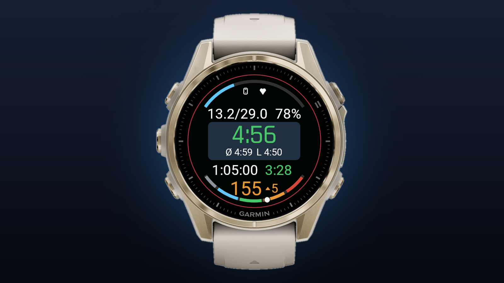

<div align="center">

# Running Race

**A pace-first Connect IQ data field for marathon racing on the Garmin fēnix 8.**




</div>

One glance, one number that matters: your pace, coloured against your target.
Everything else sits quietly around it and only speaks up when it has to.

## Highlights

| | |
|---|---|
| **Hero pace** | Smoothed current pace, large and centred. Green on target · orange too fast · red too slow. Ø-pace for the race and L-pace for the current kilometre sit right underneath. |
| **Distance** | Shown as *run / still to run*: `0.0/42.2` on the start line, `10.0/32.2` at ten kilometres, `21.1/21.1` at halfway. |
| **Race reserve** | A running stamina estimate from pace, heart rate and (optionally) power. Neutral until it runs low, then one red warning. |
| **Two arcs** | Race progress fills the top, left to right. Heart-rate zones run along the bottom, zoomed to 100 bpm – zone 5 so the range you actually race in fills the whole bar. |
| **Drift detection** | A trend arrow next to your heart rate compares it with its own 5-minute average and turns red when drift is detected. |
| **Alerts** | Nutrition reminders by time or distance, plus short feedback every 5 km. |
| **Sensor status** | Phone and chest-strap connection at a glance. |
| **Race setup on the wrist** | Distance, target pace, goal time and tolerance, editable on the start line without a phone. |
| **Built not to freeze** | A synthetic 42 km race, including an auto-pause and a GPS dropout, runs as part of the test suite. |

## Reading the face

```
        ▁▂▃ race progress ▃▂▁          top arc, fills left to right
          phone      heart
     13.2/29.0       78%               run / still to run  ·  reserve
   ┌──────────────────────┐
   │         4:56         │            current pace, coloured vs. target
   │    Ø 4:59   L 4:50   │            race average  ·  current kilometre
   └──────────────────────┘
      1:05:00      3:28                elapsed time  ·  projected finish (h:mm)
        155 ▲5                         heart rate  ·  drift trend
        ▔▔▔ HR zones ▔▔▔               bottom arc, zones 1–5
```

## Setting up a race

Target pace and race distance can be set **on the watch**, from the phone, or by
the course you are running — in that order of authority.

**On the watch** (no phone needed, works on the start line): open the activity
menu while the field is on a data screen and pick the field's settings. Data
fields are not allowed to take input while they are drawing, so the system
pushes this menu itself — see `AppBase.getSettingsView()`.

```
Race Setup ─┬─ Distance     5 / 10 / 15 / HM / 25 / 30 / Marathon / 50 km
            │              ... plus "Custom ..." for anything else, 100 m steps
            ├─ Target pace  UP / DOWN in 5 s/km steps, START confirms
            ├─ Goal time    UP / DOWN in whole minutes
            └─ Tolerance    how far off pace still counts as green
```

A change takes effect within 10 seconds — the field re-reads its targets on its
next heavy refresh, so it does not need the activity restarted.

**Goal time is not a separate setting.** It is target pace × race distance, so
editing the pace moves the goal time and editing the goal time back-computes the
pace. The two can never contradict each other, and everything downstream (the
finish projection's colour, the progress arc, the reserve drain) follows.

**A loaded course wins.** When navigating a route, the real remaining distance
comes from the watch (`Activity.Info.distanceToDestination`) and the race becomes
as long as the course is. A course measuring 42.4 km moves the remaining
distance, the progress arc, the reserve and the goal time onto 42.4 km together.
(PacePro's target pace is not exposed to Connect IQ; the route is.)

**From the phone**, the Connect IQ settings hold the same values — the distance
as free-form metres, so a measured course can be entered exactly.

## Build & run

### Quick way (recommended)

`run.ps1` compiles and launches the field in the Connect IQ simulator in one
step. Run it from this folder in a PowerShell terminal:

```powershell
.\run.ps1                 # build + launch on fenix843mm (default)
.\run.ps1 -BuildOnly      # compile only, no simulator
.\run.ps1 -Test           # build + run the unit tests
.\run.ps1 -Deploy         # release build + copy onto a connected watch
.\run.ps1 -Device fr965   # target a different device
.\run.ps1 -Shot           # build + launch + save bin\sim_shot.png (screenshot)
```

`-Deploy` builds with `-r` (release) and copies the PRG into `GARMIN\Apps` on
the watch. The fenix 8 mounts over MTP, so it has no drive letter and ordinary
file copying cannot reach it — the script goes through the Windows shell
namespace instead, and verifies the file actually arrived (MTP copies are
asynchronous and fail silently). Connect the watch by USB and unlock it first.
Afterwards, unplug it and add the field to a running activity's data screens.

`-Shot` captures the simulator window to `bin\sim_shot.png` (gitignored) so the
rendered layout can be reviewed without taking a manual screenshot.

It auto-detects the SDK (even if it is not on your PATH), signs with
`developer_key_pkcs8.der`, builds with `-w` (warnings-as-errors), and reuses an
already-open simulator instead of starting a second one.

### Manual way

1. Install the Connect IQ SDK (via the SDK Manager).
2. Add the SDK's `bin\` folder to your PATH, or use the full path to `monkeyc.bat`.
3. Create your own developer key (or use the existing `.der`). Do not commit private keys.
4. Build from the project root:

```powershell
monkeyc -f monkey.jungle -o bin\Running_Race.prg -y your_key.der -d fenix843mm -w
```

5. Run in the simulator — start it first, then load the app:

```powershell
connectiq                                   # start the simulator, leave open
monkeydo bin\Running_Race.prg fenix843mm    # load the app into it
```

## Tests

**Run these before flashing a build you intend to race with.**

```powershell
.\run.ps1 -Test
```

This builds `test.jungle` (the normal sources plus `test/`) with `--unit-test`
and runs the Run No Evil suite in the simulator. It exits non-zero if anything
fails, so it can gate a commit.

The suite drives the real `RaceEngine.tick()` — the same entry point the watch's
`compute()` uses — through a synthetic race: standing on the start line, 30 min
on pace, an auto-pause shoe stop, a 9:55/km crawl, a GPS dropout, then the rest
of the 42 km. On top of the usual value assertions it checks the things that
actually take a data field down mid-run: that the sample buffers stay bounded,
that memory does not grow over an hour of racing, that a 12 km GPS jump is
absorbed in one step, and that hostile sensor data (null, negative, absurd, a
clock that steps backwards) never throws.

The marathon test takes a minute or two. That is the point — the crash it guards
against only appears once the buffers have filled up.

The settings side is covered too: the suite builds the real on-watch menu, steps
each value into its clamps, renders the adjuster into a buffered bitmap (so a bad
font or primitive fails here rather than on the wrist), and drives a target
change through a running race to prove it lands within one heavy refresh. What it
cannot cover is the system *invoking* `getSettingsView()` from the activity menu
— that is platform behaviour; check it once on the watch after installing.

## Repo Notes

- `bin/` and signing keys are ignored through `.gitignore`.
- Keep `source/` and `resources/` under version control.
